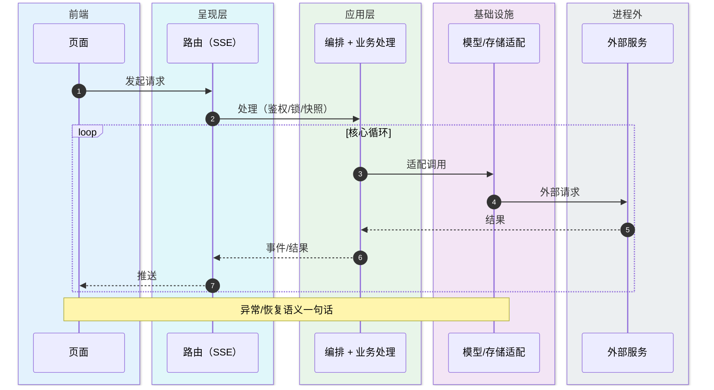

# Pao Project Quickstart —— 项目快速上手分析

当用户希望系统地了解一个陌生的代码仓库时调用本 skill。**全程使用中文输出**，按三个步骤一次性完成分析，产出一份带双图（时序图 + 架构图）的 Markdown 入门指南。

核心特点：

1. **§1.6 请求路径总览**：文字链路 + 多颜色 Mermaid 时序图
2. **§2.0 整体架构视角**：逐模块分析前先画分层颜色分块架构图，领域层展开为与实际目录一一对应的子模块
3. **精炼优先**：图只承担「导航」职责，机制细节留给正文小节
4. **双图配色一致**：读者可在两图间对照同一架构层

---

## 0. 启动前的准备

1. **确认分析目标**
   - 用户已提供项目路径则直接使用；当前工作目录就是项目则直接使用。
   - 都没有时，请用户选择/提供项目文件夹（使用宿主提供的目录选择工具，没有则直接询问）。
   - 路径不确定时可先用系统搜索（如 macOS `mdfind -name <项目名>`）定位候选，向用户确认。

2. **建立任务清单**（用宿主的 Todo 工具，便于用户观察进度）：
   - 步骤 1：分析项目整体架构
   - 步骤 2：逐一分析核心模块（含 2.0 架构图）
   - 步骤 3：分析项目维护方式
   - 验证：核对遗漏 + 生成最终报告

3. **快速侦察**（一次 bash 完成）：
   ```bash
   ls -la <项目根目录> && \
   find <项目根目录> -maxdepth 2 -type d -not -path '*/node_modules*' -not -path '*/.git*' | head -40 && \
   find <项目根目录> -maxdepth 2 -type f \( \
     -name 'README*' -o -name 'package.json' -o -name 'pyproject.toml' \
     -o -name 'pom.xml' -o -name 'build.gradle*' -o -name 'Cargo.toml' \
     -o -name 'go.mod' -o -name 'composer.json' -o -name 'Gemfile' \
     -o -name 'Makefile' -o -name 'Dockerfile' -o -name 'docker-compose*' \
     -o -name 'AGENTS.md' -o -name 'CONTRIBUTING*' -o -name 'CHANGELOG*' \
   \) 2>/dev/null
   ```
   注意：`AGENTS.md` / `CLAUDE.md` 等 AI 协作约定文件必须优先读取——它们常包含交付门禁与协作规则，直接影响「维护方式」结论。

---

## 步骤 1：项目整体架构分析

### 1.1 编程语言与技术栈
- 主要语言按代码量排序：`cloc` / `tokei`（如可用），否则 `find . -name '*.<ext>' | wc -l`（排除 vendor/node_modules/.venv）
- 运行时版本：`.tool-versions`、`.nvmrc`、`.python-version`、Dockerfile base image、`engines` 字段

### 1.2 框架与核心依赖
读依赖清单（`package.json`、`pyproject.toml`、`requirements*.txt`、`pom.xml`、`go.mod`、`Cargo.toml` 等），识别 Web 框架、数据访问层、前端框架、测试框架、基础设施依赖（数据库/缓存/消息队列，参考 compose/k8s 清单）。内部依赖（workspace 包、vendor wheels）单独指出维护位置。

### 1.3 项目背景与功能
- 优先读 `README*` / `docs/` 首页 / 依赖清单 description
- 顶级目录名 + 路由/Controller/Service 命名推断核心业务
- `git log --reverse --oneline | head -5` 看项目起源
- 输出：项目类型 + 3-5 行简介；README 中「已验证 vs 待验收」的边界要如实转述，不夸大

### 1.4 构建方式
汇总命令表（安装依赖 / 本地启动 / 单元测试 / 构建 / 容器 / 部署），来源：`scripts`、Makefile target、CI workflow 交叉验证。多种启动模式（演示/工作区/外部服务）分别列出。

### 1.5 顶层目录结构与入口文件
1-2 级目录树，每个目录一句话说明；明确标注各进程入口（HTTP / worker / CLI / 前端）。

### 1.6 请求路径总览（文字链路 + 多颜色时序图）
- 先用一段简洁文字链路描述一条典型请求：入口 → 编排 → 核心处理 → 外部依赖 → 响应/事件回传
- 再画一张 **Mermaid `sequenceDiagram`**，用 `box rgb(...)` 按架构层给参与者分组着色，颜色与 §2.0 架构图一致
- **精炼硬约束**：参与者 ≤7（同层职责相近的合并）、消息 ≤25 条；用 `loop`/`alt`/`opt` 表达循环/分支/可选流程，一条 `note` 概括恢复/重连等异常语义；参数级细节（超时秒数、哈希算法等）不写进图
- 图后 1-2 句点出关键事实（如执行在哪个进程、什么不经过哪条链路）

时序图骨架示例：



---

## 步骤 2：核心模块逐一分析

### 2.0 整体架构视角（必须先画架构图，再过渡到小模块）

在逐模块分析之前，先给一节「整体架构视角」，包含一张 **Mermaid `flowchart` 架构图**：

- **按架构层分 subgraph**（前端 / 呈现 / 应用 / 领域 / 基础设施 / 进程外依赖，按项目实际分层调整），箭头体现**依赖方向**（洋葱架构：外层依赖内层，虚线表示「端口由外层实现」）
- **每个节点标注对应剖析小节编号**（如 §2.3）；装配根 / DI 入口等特殊角色单独成节点
- **颜色分块（必须）**：`classDef` 给每层节点统一配色（浅色填充 + 同系深色描边），subgraph 用对应更浅底色（`style`），图后附一行配色说明
- **领域层/核心层展开为子模块节点**，与实际目录一一对应（DDD 项目按子域逐个画），不能压成一个笼统大节点；连线细化到子模块
- **精炼硬约束**：节点文案每个 1 行；同源箭头用 `A --> B & C` 合并；读图要点 4-6 条、每条一两句
- 图后写「读图要点」（依赖规则、装配根位置、一条请求的纵向切面、独立支线、权威数据归属），最后一句**过渡**说明后续小节展开顺序（如「先装配 → 请求主干 → 横切治理 → 能力支线 → 底座与出入口」）

**统一配色表**（两张图共用）：

| 层 | classDef 填充/描边 | sequenceDiagram box rgb |
| --- | --- | --- |
| 前端 | `#e3f2fd` / `#1565c0` | `227,242,253` |
| 呈现层 | `#e0f7fa` / `#00838f` | `224,247,250` |
| 应用层 | `#e8f5e9` / `#2e7d32` | `232,245,233` |
| 领域层（圆心） | `#fff8e1` / `#f9a825` | `255,248,225` |
| 基础设施 | `#f3e5f5` / `#7b1fa2` | `243,229,245` |
| 装配根 | `#ffebee` / `#c62828` | — |
| 进程外依赖 | `#eceff1` / `#546e7a` | `236,239,241` |

### 2.1 识别核心模块
- 从 1.5 顶层目录入手，业务/领域目录作为核心模块；monorepo 每个子项目作为模块
- 超过 12 个时按**最近 3 个月修改频次**（`git log --since='3 months ago' --name-only | sort | uniq -c | sort -rn`）取 Top 8-10，明确告知裁剪规则

### 2.2 对每个模块输出以下子项

- **设计缘由（Why）**：解决什么业务/技术问题；核心域/支撑域/通用域角色；证据优先来自模块内 README/注释/ADR/commit message
- **设计原则**：单一职责体现、依赖方向是否健康、对外接口（API/路由/事件）
- **设计模式**：给出**文件位置佐证**（创建型/结构型/行为型/架构层面：Repository、Hexagonal、DDD 分层、Event-driven、Saga 等）
- **文件分布**：源码 / 接口类型 / 测试（与源码对应关系）/ 配置 / 文档

输出格式：
```
### 模块：<模块名>
- 路径：<相对路径>
- 设计缘由：…
- 设计原则：…
- 设计模式：…（含代码位置佐证）
- 关键文件：源码 / 接口 / 测试 / 配置
```

---

## 步骤 3：项目维护方式

逐项调查（无证据的项写「未发现」，不编造）：

1. **版本控制与协作**：分支策略、提交规范（Conventional Commits 痕迹）、PR 模板、CODEOWNERS；`AGENTS.md` 等 AI 协作约定单独概括
2. **CI/CD**：平台、pipeline stage、部署触发条件、产物分发
3. **测试策略**：单测/集成/E2E 位置与命令、覆盖率工具、Mock/Fixture 组织；项目自带评测门禁（如 eval 套件）重点说明
4. **代码质量**：Linter/Formatter/静态分析/pre-commit；注意区分「有缓存痕迹」与「已固化配置」
5. **发布流程**：版本号策略、changelog 方式、发布渠道；能力/配置发布门禁（审核→发布分离）也算发布流程
6. **文档维护**：README/ADR/改动记录制度/文档站点/API 文档生成
7. **监控运维**（如适用）：日志规范、Trace/指标/告警、备份约定

---

## 验证与最终交付

1. **遗漏核对**：扫根目录未提及的关键配置（`BUILD.bazel`、`turbo.json`、`.editorconfig`、`.env.example`、`renovate.json`、`*.config.*` 等）
2. **双图自检**：两图分层配色一致；时序图参与者 ≤7、消息 ≤25；架构图节点单行、领域层与目录一一对应；Mermaid 语法可渲染（`box rgb` 需 Mermaid ≥10.3，注明）
3. **报告生成**：汇总为一个 Markdown 文件，保存到宿主 outputs 目录：
   - 文件名：`项目入门指南-<项目名>-<YYYYMMDD>.md`
   - 顶部 TOC（含 1.6 与 2.0）；报告头注明分析日期与 git 基线 commit
   - 末尾附「**下一步建议**」3-5 条具体学习路径（如「从 X 入口 Y 函数 trace 一条典型请求」，给出 file:line）
4. **交付**：用宿主的文件呈现工具展示报告，回复附不超过 5 行的概括总结

---

## 注意事项

- **全程中文输出**（标题、表格、图内文案；代码标识符保留英文）
- 不确定的设计缘由标注「推测」，不伪造证据；README 声明的「待验收」边界如实转述
- 模块超过 12 个主动裁剪并告知规则
- 优先 Grep/Glob/bash 大范围扫描，避免逐文件 Read；>100k LOC 项目用子代理并行调查各步骤
- **图表精炼优先**：图只承担导航职责，细节写进正文小节；宁可少画细节也不要冗长
- 用户要求「只看某一步」按指令调整，默认完整跑完三步